<p align="center">
  
</p>

<div align="center">

[](https://github.com/netspeedy)
[](scripts/readme/build_profile_graphics.py)
[](scripts/readme/build_profile_graphics.py)

</div>

This repository holds the public profile shown at [github.com/netspeedy](https://github.com/netspeedy). GitHub renders [`profile/README.md`](profile/README.md) on the organization's page; everything else here exists to build it.

The prose in that README is written by hand. Every image in `profile/assets/` is generated, and so is the Selected Public Work grid, which is rebuilt from a list of the public projects. That keeps the cards, the tool counts and the Homebrew tap badges in step whenever a repository is added.

## What's here

| Path | Purpose |
| --- | --- |
| [`profile/README.md`](profile/README.md) | The organization profile GitHub renders. |
| [`profile/assets/`](profile/assets) | The generated graphics, and the 1280x640 social preview. |
| [`scripts/readme/projects.json`](scripts/readme/projects.json) | The public projects shown on the profile. |
| [`scripts/readme/build_profile_graphics.py`](scripts/readme/build_profile_graphics.py) | Builds every graphic and rewrites the project grid. |
| [`AGENTS.md`](AGENTS.md) | Maintainer guidance, including the fields for a new project. |

## Updating the profile

Change the generator or its data, never an SVG, then rebuild and check:

```bash
make readme-graphics
make check
```

The build needs [uv](https://docs.astral.sh/uv/), network access the first time (it downloads the pinned fonts), and Chrome or Chromium for the social preview. A rebuild with unchanged content leaves every file byte-identical, and anything too wide to fit stops the build with a message naming it.

To add a public project, add an entry to `scripts/readme/projects.json` and run `make readme-graphics`. Its card, its place in the grid, its tap badge, its tile in the signals graphic and both tool counts follow. [AGENTS.md](AGENTS.md#adding-or-changing-a-public-project) lists the fields.

After the banner changes, upload `profile/assets/netspeedy-social-card.png` under Settings, General, Social preview, as GitHub has no API for it.

## Related

The same generator, with different content, builds Simon Oakes' profile at [github.com/soakes](https://github.com/soakes). KuberTech, the Kubernetes and GitOps part of Netspeedy, is at [kubertech.io](https://kubertech.io) and [kubertech.dev](https://kubertech.dev).
