  

  

> Infrastructure engineering, automation, networking and platform operations, built from real systems and run with production habits.

## What Netspeedy Is

Netspeedy is a long-running infrastructure engineering environment covering Linux systems, automation, Kubernetes, GitOps, DNS, certificates, networking, storage, CI/CD, self-hosted services and operational tooling.

The point is practical engineering, not isolated demo content. The work behind Netspeedy is built around the same habits expected in production environments: clear ownership, repeatable change, source-controlled intent, careful automation, observable behaviour and recovery paths that are understood before they are needed.

This public profile focuses on the engineering approach, selected public work and platform story that represent Netspeedy externally.

## Operational Signals

  

## Selected Public Work

Operator-facing tools built and maintained under Netspeedy, each solving one production problem cleanly.

<!-- projects:start -->

  
  
  
  
  
  

Each card opens its repository. Homebrew taps for the tools above:

<!-- projects:end -->

## How We Work

Good infrastructure work is not just about deploying things. It is about making change understandable, repeatable and safe enough that future maintenance is not a gamble.

  

## KuberTech

KuberTech is the Kubernetes and GitOps platform part of Netspeedy. It shows how workloads, platform services, environment separation and promotion paths are handled, as one part of a wider infrastructure and automation environment rather than the whole of it.

  
  

## Background

Netspeedy is maintained by Simon Oakes, a UK-based Senior Linux, DevOps and Platform Engineer with 25+ years of experience across ISP infrastructure, media platforms, CI/CD systems, virtualisation, networking, storage, automation and production operations.

  
  

---

**Infrastructure should be boring for the right reasons: clear state, controlled change and recovery paths that work.**

